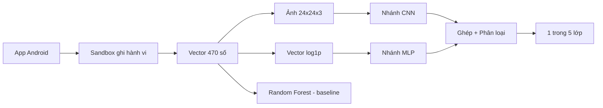
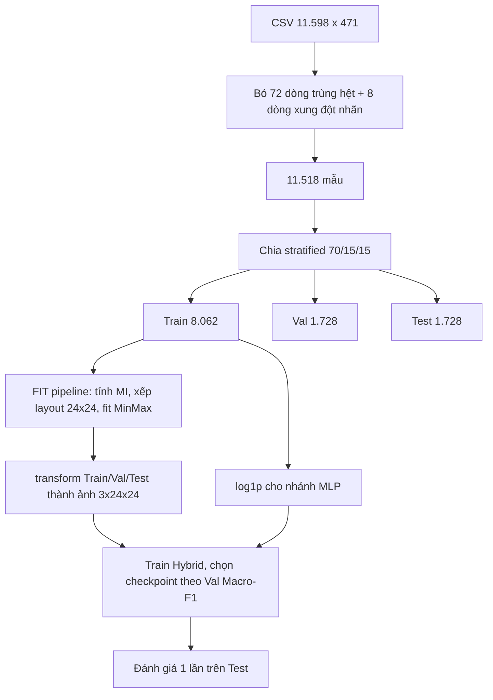

# 📘 Học đồ án IE105 từ số 0 – Phân loại mã độc Android bằng Hybrid CNN

> Mục tiêu: đọc xong file này bạn **hiểu từng quyết định trong đồ án** và **tự trình bày + trả lời phản biện** như người trực tiếp làm ra nó.
>
> Cách học gợi ý: đọc lần lượt từ Phần 1 → 9. Mỗi phần có mục **"✅ Tự kiểm tra"** – trả lời được thì qua phần sau.

---

## Mục lục

1. [Bức tranh tổng thể (đọc 5 phút là nắm)](#1-bức-tranh-tổng-thể)
2. [Kiến thức nền cần biết](#2-kiến-thức-nền-cần-biết)
3. [Dữ liệu: CICMalDroid2020](#3-dữ-liệu-cicmaldroid2020)
4. [Luồng xử lý end-to-end](#4-luồng-xử-lý-end-to-end)
5. [Đi qua code từng file](#5-đi-qua-code-từng-file)
6. [Kết quả và cách đọc kết quả](#6-kết-quả-và-cách-đọc-kết-quả)
7. [Hạn chế – phải biết để không bị "bắt bài"](#7-hạn-chế--phải-biết-để-không-bị-bắt-bài)
8. [Kịch bản thuyết trình 7–10 phút](#8-kịch-bản-thuyết-trình-710-phút)
9. [Bộ câu hỏi phản biện + đáp án](#9-bộ-câu-hỏi-phản-biện--đáp-án)
10. [Từ điển thuật ngữ](#10-từ-điển-thuật-ngữ)
11. [Lộ trình tự học + bài tập thực hành](#11-lộ-trình-tự-học--bài-tập-thực-hành)

---

## 1. Bức tranh tổng thể

**Bài toán:** Cho một ứng dụng Android, đoán nó thuộc **1 trong 5 lớp**:

| Nhãn trong file | Lớp | Ý nghĩa |
|:---:|---|---|
| 1 | Adware | Hiện quảng cáo phiền nhiễu |
| 2 | Banking | Trojan ngân hàng, đánh cắp tài khoản |
| 3 | SMS Malware | Gửi tin nhắn trả phí, chặn SMS |
| 4 | Riskware | Ứng dụng "lưng chừng", có thể bị lợi dụng |
| 5 | Benign | Ứng dụng sạch |

**Đầu vào:** mỗi ứng dụng được chạy trong **sandbox** (môi trường giả lập an toàn), ghi lại **app đã làm gì** → thành **1 dòng gồm 470 con số** (ví dụ: gọi hàm `open` 1.203 lần, gửi SMS 5 lần...). Đây là **phân tích động** (quan sát hành vi khi chạy) chứ không phải phân tích tĩnh (đọc code APK).

**Ý tưởng chính của đồ án (1 câu):**
> Biến mỗi dòng 470 số thành một **"bức ảnh" 24×24 có 3 kênh màu**, xếp các đặc trưng giống nghĩa nằm gần nhau, rồi cho **CNN** học; đồng thời cho **MLP** học vector gốc; ghép 2 nhánh lại (**Hybrid**). So sánh với **Random Forest** làm mốc (baseline).

**Kết quả (1 câu):**
> RF đạt **95.90%**, Hybrid **95.64%**, MLP **95.68%**, CNN **95.36%** (trung bình 5 lần chạy). → Biến bảng thành ảnh giúp CNN từ **86% lên ~95%**, nhưng **mô hình cây vẫn là tốt nhất** cho dữ liệu dạng bảng.



### ✅ Tự kiểm tra
- Đầu vào của mô hình là gì? Có bao nhiêu lớp đầu ra?
- Tại sao gọi là "Hybrid"?
- Baseline là gì, vì sao cần baseline?

---

## 2. Kiến thức nền cần biết

> Chỉ học **đủ dùng cho đồ án này**, không cần học sâu hơn.

### 2.1. Dữ liệu dạng bảng (tabular) vs ảnh
- **Bảng:** mỗi cột là 1 đặc trưng có ý nghĩa riêng, **thứ tự cột không quan trọng** (đổi chỗ cột A, B không đổi ý nghĩa).
- **Ảnh:** pixel cạnh nhau **có liên quan** với nhau (pixel cạnh mắt thường cũng là mắt). Tính chất này gọi là **tính cục bộ không gian (spatial locality)**.
- 👉 CNN mạnh vì khai thác tính cục bộ. Dữ liệu bảng **không có** tính chất này → đó là thử thách cốt lõi của đồ án.

### 2.2. Random Forest (RF)
- **Cây quyết định:** hỏi liên tiếp các câu "có/không", ví dụ *"gọi `sendTextMessage` > 3 lần?" → Có → "đọc danh bạ?" → ...*
- **Rừng ngẫu nhiên:** train **nhiều cây** (đồ án dùng 150), mỗi cây học trên một mẫu dữ liệu bốc ngẫu nhiên có hoàn lại (**bootstrap**) và một tập con đặc trưng ngẫu nhiên → **bỏ phiếu**.
- Ưu điểm: không cần chuẩn hóa, xử lý rất tốt dữ liệu thưa/rời rạc, nhanh (~0.6 giây).

### 2.3. MLP (Multi-Layer Perceptron)
- Mạng nơ-ron "thường": các lớp `Linear` (nhân ma trận + cộng bias) xen kẽ hàm kích hoạt `ReLU` (`max(0, x)`).
- Mỗi nơ-ron nhìn **toàn bộ** 470 đặc trưng cùng lúc → học được quan hệ **toàn cục**.

### 2.4. CNN (Convolutional Neural Network)
- **Conv 3×3:** một "cửa sổ" 3×3 trượt khắp ảnh, mỗi vị trí tính tổng có trọng số của 9 ô → phát hiện **mẫu cục bộ**.
- **MaxPool 2×2:** lấy max mỗi ô 2×2 → ảnh nhỏ đi một nửa.
- **Kích thước sau conv không padding:** `out = in - kernel + 1` (24 → 22).
- Điểm mấu chốt: CNN chỉ có ích khi **ô cạnh nhau thực sự liên quan**.

### 2.5. Các kỹ thuật "phụ" trong mạng
| Kỹ thuật | Hiểu nôm na | Trong đồ án để làm gì |
|---|---|---|
| **BatchNorm** | Chuẩn hóa đầu ra mỗi lớp về trung bình 0, phương sai 1 trong mỗi batch | Train ổn định, nhanh hơn |
| **Dropout** | Tắt ngẫu nhiên một số nơ-ron khi train | Chống học vẹt (overfitting) |
| **Dropout2d** | Tắt nguyên cả một kênh feature map | Như trên, cho CNN |
| **AdamW** | Thuật toán cập nhật trọng số + weight decay (phạt trọng số lớn) | Tối ưu hóa |
| **OneCycleLR** | Learning rate tăng dần lên đỉnh rồi giảm dần | Hội tụ nhanh, kết quả tốt hơn |
| **Early Stopping** | Val không cải thiện sau N epoch thì dừng | Tiết kiệm thời gian, chống overfit |
| **Label Smoothing 0.1** | Thay nhãn "100% Adware" bằng "~90% Adware, phần còn lại chia đều" | Mô hình bớt "tự tin thái quá" |
| **Class Weight** | Lớp ít mẫu bị đoán sai thì phạt nặng hơn | Xử lý mất cân bằng lớp |

### 2.6. Các phép biến đổi dữ liệu
- **log1p(x) = log(1 + x):** nén số lớn. `log1p(0)=0`, `log1p(9)≈2.3`, `log1p(3.600.000)≈15.1`. → Số triệu và số chục không còn cách nhau quá xa.
- **Min-Max Scaling:** `(x - min) / (max - min)` → về [0, 1]. **Vấn đề:** nếu max = 3.6 triệu thì giá trị 100 thành 0.00003 ≈ 0 → "ảnh đen kịt". **Cách giải quyết:** log1p trước rồi mới Min-Max.

### 2.7. Mutual Information (MI – thông tin tương hỗ)
- Câu hỏi MI trả lời: **"Biết giá trị đặc trưng này thì đoán nhãn dễ hơn bao nhiêu?"**
- MI = 0 → đặc trưng vô dụng; MI càng lớn → càng hữu ích.
- **Vì sao không dùng Pearson?** Pearson đo quan hệ **tuyến tính giữa 2 số**. Nhãn 1..5 là **tên loại**, không có thứ tự (Benign=5 không "lớn hơn" Adware=1). Pearson coi chúng là số → vô nghĩa. MI không giả định thứ tự, bắt được cả quan hệ phi tuyến.

### 2.8. Đánh giá mô hình
- **Train / Val / Test:** Train để học; Val để chọn mô hình/dừng sớm; Test **chỉ dùng 1 lần** ở cuối để báo cáo. Giống: học bài – làm đề thử – thi thật.
- **Stratified split:** chia sao cho tỉ lệ 5 lớp ở mỗi tập giống nhau.
- **Accuracy:** % đoán đúng. **Dễ bị lừa** khi lớp mất cân bằng.
- **Precision (lớp A):** trong các mẫu mô hình nói là A, bao nhiêu % đúng là A.
- **Recall (lớp A):** trong các mẫu thật sự là A, mô hình bắt được bao nhiêu %.
- **F1** = trung bình điều hòa của Precision và Recall.
- **Macro-F1** = trung bình F1 của 5 lớp, **mỗi lớp nặng như nhau** → lớp ít mẫu (Adware) không bị "chìm".
- **Data leakage (rò rỉ dữ liệu):** thông tin của tập Test lọt vào lúc train → kết quả ảo. Ví dụ: cùng 1 mẫu nằm ở cả Train và Test; hoặc fit scaler trên toàn bộ dữ liệu.
- **Ablation study:** bỏ bớt từng thành phần để xem thành phần đó đóng góp bao nhiêu.

### ✅ Tự kiểm tra
- Vì sao CNN hợp với ảnh nhưng không tự nhiên hợp với bảng?
- Vì sao phải log1p trước Min-Max?
- Vì sao dùng Macro-F1 thay vì Accuracy để chọn mô hình?
- Pearson sai ở đâu khi dùng cho nhãn phân loại?

---

## 3. Dữ liệu: CICMalDroid2020

- File dùng: [471_extracted features.csv](file:///d:/IE105/Common_Data/471_extracted%20features.csv) → **11.598 dòng × 471 cột** (470 đặc trưng + cột `Class`).
- Không có giá trị thiếu (NaN), không có số âm, toàn là **số đếm** (bao nhiêu lần gọi).
- **Thưa:** ~78% giá trị là 0 (đa số app không gọi đa số hàm).
- **Ngoại lai cực lớn:** có hàm bị gọi > 3.6 triệu lần.

**Phân bố lớp (mất cân bằng):**

| Lớp | Số mẫu | Tỉ lệ |
|---|---:|---:|
| SMS Malware | 3.904 | 33.7% |
| Riskware | 2.546 | 22.0% |
| Banking | 2.100 | 18.1% |
| Benign | 1.795 | 15.5% |
| Adware | 1.253 | 10.8% |

**470 đặc trưng gồm:**
- **139 system call** của nhân Linux (`open`, `read`, `write`, `clone`, `futex`, `ioctl`…) – danh sách ở [syscall_unique.csv](file:///d:/IE105/Common_Data/syscall_unique.csv).
- **331 hành vi tầng Android:** mạng, quyền, SMS, crypto, intent, service…

**Các file dữ liệu khác trong `dataset/CSV`:** file 139 cột (chỉ syscall – bản cũ dùng, đã bỏ) và file 50.000 cột (~600MB, không dùng, bị `.gitignore`).

### ✅ Tự kiểm tra
- Dữ liệu có bao nhiêu mẫu, bao nhiêu đặc trưng? Lớp nào ít nhất?
- "Thưa" và "ngoại lai" gây khó khăn gì cho Min-Max?

---

## 4. Luồng xử lý end-to-end



> 🔑 **Nguyên tắc vàng chống leakage:** mọi thứ "học từ dữ liệu" (MI, layout, MinMax) chỉ **fit trên Train**, sau đó **transform** Val/Test. Đồ án làm đúng điều này.

---

## 5. Đi qua code từng file

### 5.1. [data_loader.py](file:///d:/IE105/Common_Data/data_loader.py) – nạp và chia dữ liệu (dùng chung CNN và RF)

Các bước trong `get_train_val_test_data()`:
1. Đọc CSV.
2. `drop_duplicates()` – bỏ dòng **giống hệt** (cả feature lẫn nhãn). Nếu không bỏ, 1 bản ở Train và 1 bản ở Test → **leakage**.
3. `duplicated(subset=feature_cols, keep=False)` – sau bước 2, nếu feature vẫn trùng thì **chắc chắn nhãn khác nhau** → mẫu mâu thuẫn (**nhiễu nhãn**), bỏ hết cả 2.
4. Chia 2 lần:
   - Lần 1: tách 15% làm Test.
   - Lần 2: từ 85% còn lại, tách `0.15/0.85 ≈ 17.6%` làm Val → Val đúng bằng 15% tổng.
   - `stratify=y` giữ tỉ lệ lớp, `random_state=42` để lần nào chạy cũng chia giống nhau.

> 💡 Vì sao dùng chung 1 hàm cho CNN và RF? → **So sánh công bằng**: hai mô hình thi cùng một đề.

### 5.2. [preprocess.py](file:///d:/IE105/CNN_Model/preprocess.py) – biến vector thành ảnh (trái tim của đồ án)

Class `FeatureToImagePipeline`, hàm `fit_transform(X, y)` gồm 5 bước:

**B1 – Chấm điểm từng đặc trưng bằng MI**
- `log1p` trước khi tính MI vì sklearn ước lượng MI bằng **k-láng giềng gần nhất** (dựa vào khoảng cách) – số triệu sẽ làm lệch khoảng cách.
- `random_state=42` vì hàm có thêm nhiễu ngẫu nhiên nhỏ.

**B2 – Phân nhóm ngữ nghĩa** (`classify_feature`)
- Nếu tên cột nằm trong danh sách syscall → `SystemCall`.
- Nếu không: tách tên thành các từ (token), ví dụ `getDeviceId` → `GET`, `DEVICE`, `ID`, rồi so với bảng từ khóa `SEMANTIC_KEYWORDS`.
  - Tách camelCase: `([a-z0-9])([A-Z])` → chèn `_`.
  - Tách theo ký tự đặc biệt rồi viết hoa.
- Vì sao so **token** chứ không so **chuỗi con**? Để tránh nhầm, ví dụ `"NET"` không khớp nhầm trong `"PLANET"`.
- Kết quả: SystemCall 139, Network 20, Privacy 18, Device 40, Crypto 8, Process 6, Android_Component 45, App_Management 23, FileSystem 19, **Other_API 152**.

**B3 – Sắp xếp trong mỗi nhóm theo MI giảm dần** → đặc trưng quan trọng nằm đầu mỗi nhóm.

**B4 – Xếp lên lưới 24×24**
- Mỗi nhóm **bắt đầu ở hàng mới**; hàng cuối của nhóm thiếu thì **đệm -1** (ô trống = 0).
- Số hàng cần cho nhóm = `ceil(count / 24)` = `(count + 23) // 24`.
- Tổng cần **23/24 hàng** → vừa đủ. Đây là lý do tăng từ 22×22 (bản cũ) lên 24×24.
- Kết quả là mảng `pixel_mapping`: `pixel_mapping[i]` = index đặc trưng ở pixel i (hoặc -1).

**B5 – Fit MinMaxScaler trên `log1p(X_train)`.**

Hàm `transform(X)` tạo **3 kênh** (giống R, G, B của ảnh màu):

| Kênh | Công thức | Ý nghĩa |
|---|---|---|
| 1 – Cường độ | `MinMax(log1p(x))` | Gọi **nhiều hay ít** so với toàn tập Train |
| 2 – Nhị phân | `x > 0 ? 1 : 0` | **Có gọi hay không** – bắt chước kiểu cây quyết định hỏi có/không |
| 3 – Chuẩn hóa theo mẫu | `log1p(x) / max(log1p(x) của chính mẫu đó)` | Hàm này chiếm tỉ trọng bao nhiêu **trong chính app đó** |

`+1e-7` ở kênh 3 để tránh chia cho 0 khi mẫu toàn số 0.

Đầu ra: mảng `(N, 3, 24, 24)`.

> 🧪 File [test_grouping.py](file:///d:/IE105/CNN_Model/test_grouping.py) dùng để in số đặc trưng mỗi nhóm và kiểm tra có đủ 24 hàng không – chạy lại mỗi khi sửa từ khóa.

### 5.3. [cnn_train.py](file:///d:/IE105/CNN_Model/cnn_train.py) – mô hình và vòng train

**`AddCoords` (CoordConv):** ghép thêm 2 kênh tọa độ X, Y (giá trị từ -1 đến 1). Lý do: conv bình thường **"không biết mình đang ở đâu"** (cùng 1 kernel áp cho mọi vị trí), nhưng ở đây **hàng nào = nhóm nào** rất quan trọng → cho mạng biết vị trí.

**`HybridMalwareModel` – theo dõi kích thước tensor (rất hay bị hỏi):**

```text
Nhánh CNN:
  Ảnh            (B, 3, 24, 24)
  + AddCoords -> (B, 5, 24, 24)
  Conv3x3, pad0 -> (B, 32, 22, 22)   + BN + ReLU
  Conv3x3, pad0 -> (B, 64, 20, 20)   + BN + ReLU
  MaxPool 2x2   -> (B, 64, 10, 10)   + Dropout2d
  Conv3x3, pad1 -> (B, 128, 10, 10)  + BN + ReLU + Dropout2d
  AdaptiveAvgPool(3,3) -> (B, 128, 3, 3)
  Flatten        -> (B, 1152)

Nhánh MLP:
  Vector log1p   (B, 470)
  Linear -> 256 + BN + ReLU + Dropout
  Linear -> 128 + BN + ReLU     -> (B, 128)

Ghép (concat):   (B, 1152 + 128 = 1280)
Classifier: Linear 1280 -> 512 + BN + ReLU + Dropout(0.5) -> Linear 512 -> 5 (logits)
```

- **Vì sao `AdaptiveAvgPool2d((3,3))` mà không phải Global Average Pooling (1×1)?** GAP gộp cả ảnh thành 1 số/kênh → **mất vị trí** → không biết tín hiệu đến từ nhóm SystemCall hay nhóm Network. Pool về 3×3 giữ được vị trí thô (trên/giữa/dưới).
- `mode` = `"hybrid"` / `"cnn"` / `"mlp"` – để làm **ablation** (bật/tắt từng nhánh, cùng classifier).

**`encode_label`:** đổi nhãn 1..5 → 0..4 vì `CrossEntropyLoss` cần nhãn bắt đầu từ 0. Dùng dict cứng thay vì `LabelEncoder` để chắc chắn mapping không đổi.

**`chuan_bi_du_lieu()`:** load data → log1p cho MLP → fit pipeline ảnh trên Train → tạo 3 `TensorDataset` (mỗi phần tử = `(ảnh, vector, nhãn)`). Tách riêng để `run_ablation.py` chỉ tính MI **1 lần** rồi dùng lại cho 15 lần train.

**`train_mot_lan()` – các quyết định quan trọng:**
- `set_seed(seed)` – cố định khởi tạo trọng số + thứ tự shuffle → chạy lại ra y hệt.
- **Class weight căn bậc 2:** `w_c = sqrt(N / (K × n_c))`. Weight "balanced" thường (không căn) phạt lớp ít mẫu quá mạnh → mô hình đoán Adware tràn lan. Lấy căn cho nhẹ bớt. Ví dụ gần đúng: Adware ≈ 1.36, SMS ≈ 0.77.
- `CrossEntropyLoss(weight=..., label_smoothing=0.1)`.
- `OneCycleLR(max_lr=5e-3)`, **step mỗi batch** (không phải mỗi epoch).
- Mỗi epoch: train → đánh giá Val → nếu **Val Macro-F1** tốt hơn thì lưu checkpoint.
- `EarlyStopping(patience=12)`: 12 epoch không tăng F1 thì dừng.
- Cuối cùng **load lại checkpoint tốt nhất** rồi mới đánh giá Test (không dùng model ở epoch cuối).

**`main()`:** `python CNN_Model/cnn_train.py --mode hybrid --seed 42`. Chỉ mode hybrid mới lưu `cnn_best_model.pth` + `cnn_pipeline.joblib` cho file dự đoán dùng.

### 5.4. [rf_train.py](file:///d:/IE105/RandomForest_Baseline/rf_train.py) – baseline
- Dùng chung `get_train_val_test_data()`.
- `log1p` cho giống input MLP. Với cây quyết định, log là **hàm đồng biến** (giữ nguyên thứ tự) → ngưỡng chia vẫn tương đương, gần như không ảnh hưởng.
- `RandomForestClassifier(n_estimators=150, class_weight="balanced", n_jobs=-1)`.

### 5.5. [run_ablation.py](file:///d:/IE105/run_ablation.py) – thí nghiệm 4 mô hình × 5 seed
- Chạy RF, MLP, CNN, Hybrid với seed 42..46 → **20 lần chạy**.
- Ghi vào [ablation_results.csv](file:///d:/IE105/ablation_results.csv) **sau mỗi lần chạy**; bị ngắt giữa chừng thì chạy lại sẽ **bỏ qua các lần đã xong**.
- In bảng **Mean ± Std** (std với `ddof=1` = độ lệch chuẩn mẫu).
- ⚠️ Nếu đổi cấu hình thì phải **xóa file CSV cũ**, nếu không nó sẽ dùng lại kết quả cũ.

### 5.6. [predict_cnn.py](file:///d:/IE105/CNN_Model/predict_cnn.py) – dùng mô hình dự đoán file mới
1. Load pipeline (chứa luôn tên 470 cột lúc train) + model (đọc `mode` trong checkpoint).
2. Đọc CSV mới, **sắp lại cột theo đúng thứ tự lúc train**; cột thiếu điền 0; cột thừa bỏ qua.
3. `pipeline.transform` → ảnh; `log1p` → vector; dự đoán theo batch.
4. `softmax` → xác suất → in "% tin cậy" + top-K.
5. Nếu có cột nhãn → tính Accuracy, Macro-F1. `parse_labels` nhận diện nhãn kiểu 1..5, 0..4 hoặc chữ (bản cũ có bug đọc sai nhãn 0..4, đã sửa).

```bash
python CNN_Model/predict_cnn.py --input "Common_Data/471_extracted features.csv" --show 10 --topk 3
```
> ⚠️ Chạy trên file gốc ra ~97% vì file chứa cả dữ liệu Train → **chỉ để demo**, không phải con số đánh giá.

### ✅ Tự kiểm tra
- Vẽ lại kích thước tensor từ (B,3,24,24) đến (B,5) không nhìn tài liệu.
- Vì sao pipeline chỉ `fit` trên Train?
- Vì sao load lại checkpoint tốt nhất trước khi test?
- 3 kênh ảnh mỗi kênh mang thông tin gì?

---

## 6. Kết quả và cách đọc kết quả

### 6.1. Lịch sử cải tiến (kể chuyện khi thuyết trình)

| Giai đoạn | Thay đổi | Accuracy |
|---|---|---:|
| 1 | Min-Max thường + xếp 470 đặc trưng **ngẫu nhiên** vào ảnh 22×22 | ~86.2% |
| 2 | log1p + gom 139 syscall lên đầu ảnh + lọc trùng | ~91.0% |
| 3 | Gom 10 nhóm + căn hàng 24×24 + MI + 3 kênh + CoordConv + nhánh MLP | ~95.6% |

> Lưu ý trung thực: giai đoạn 1–2 dùng dữ liệu/tiền xử lý cũ nên so sánh chỉ mang tính tham khảo.

### 6.2. Ablation 5 seed trên Test (1.728 mẫu)

| Mô hình | Accuracy (%) | Macro-F1 | Thời gian train |
|---|:---:|:---:|:---:|
| **Random Forest** | **95.90 ± 0.08** | **0.9515 ± 0.0011** | ~0.6s |
| MLP-only | 95.68 ± 0.37 | 0.9480 ± 0.0040 | ~26s |
| Hybrid CNN+MLP | 95.64 ± 0.32 | 0.9475 ± 0.0036 | ~280s |
| CNN-only | 95.36 ± 0.18 | 0.9449 ± 0.0021 | ~275s |

### 6.3. Đọc bảng thế nào (đây là phần thể hiện bạn "hiểu bản chất")
1. **RF thắng cả 3 tiêu chí:** chính xác nhất, ổn định nhất (std nhỏ nhất), nhanh nhất.
2. **Hybrid ≈ MLP:** chênh 0.04% trong khi std ~0.35% → **không có khác biệt có ý nghĩa**. Nghĩa là nhánh CNN **chưa đóng góp thêm** gì so với chỉ dùng MLP.
3. **CNN-only vẫn đạt 95.36%** → cách xếp ảnh có tác dụng (so với 86% khi xếp ngẫu nhiên), nhưng chưa vượt được MLP.
4. **Theo lớp:** SMS Malware dễ nhất (F1 ~0.99, hành vi gửi SMS rất đặc trưng); **Adware khó nhất** (F1 ~0.91, precision thấp – nhiều app khác bị đoán nhầm thành Adware, vì Adware hành xử khá giống app thường).

### 6.4. Vì sao RF thắng? (giải thích bản chất)
- Dữ liệu là **số đếm, thưa, rời rạc**. Ranh giới quyết định dạng "hàm X được gọi > k lần" → **song song với trục tọa độ** – đúng kiểu cây quyết định cắt.
- Mạng nơ-ron học ranh giới **trơn/xiên**, cần nhiều dữ liệu hơn để xấp xỉ các bậc thang này.
- Nghiên cứu học thuật (vd. Grinsztajn et al., 2022 – *"Why do tree-based models still outperform deep learning on tabular data?"*) cũng kết luận tương tự.

---

## 7. Hạn chế – phải biết để không bị "bắt bài"

> Tự nói ra hạn chế trước = ghi điểm. Bị hội đồng chỉ ra = mất điểm.

1. **Tính cục bộ của ảnh là "nhân tạo":** 2 ô cạnh nhau chỉ là 2 đặc trưng **có điểm MI gần nhau** trong cùng nhóm, không chắc có quan hệ với nhau. Ô trên–dưới (cách 24 vị trí) gần như không liên quan. → CNN không có cấu trúc thật để khai thác → lý do CNN ≤ MLP.
2. **Kernel 3×3 vẫn trộn 2 nhóm theo chiều dọc** ở hàng ranh giới; zero-padding chỉ tách theo chiều ngang. Không đủ hàng trống để chèn hàng phân cách cho 10 nhóm.
3. **Nhóm `Other_API` còn 152/470 đặc trưng (32%)** – từ khóa tự liệt kê bằng tay, chưa phủ hết.
4. **Std chỉ phản ánh độ ngẫu nhiên khi train**, không phản ánh cách chia dữ liệu (luôn `random_state=42`). Nên dùng k-fold cross-validation.
5. **Chưa kiểm định thống kê** (paired t-test / McNemar) khi so sánh các mô hình chênh nhau <0.5%.
6. **Chỉ 1 bộ dữ liệu** – chưa thử dữ liệu khác (Drebin, AndroZoo) để kiểm tra khả năng tổng quát.
7. **Siêu tham số chọn theo kinh nghiệm**, chưa tuning bài bản (Optuna/GridSearch). RF cũng chưa tuning – nếu tuning RF có thể còn cao hơn.
8. Nhỏ: input MLP chỉ log1p chưa chuẩn hóa; EarlyStopping có thể cắt OneCycleLR trước khi LR giảm hết; có 14 cột trùng nhau hoàn toàn.

---

## 8. Kịch bản thuyết trình 7–10 phút

**Slide 1 – Mở đầu (30s)**
> "Mã độc Android ngày càng dùng kỹ thuật làm rối code (obfuscation) để qua mặt phân tích tĩnh. Nhóm em tiếp cận bằng **phân tích động**: quan sát hành vi thật của ứng dụng trong sandbox, trên bộ CICMalDroid2020 với 5 lớp."

**Slide 2 – Dữ liệu (1 phút)**
> "11.598 mẫu, 470 đặc trưng hành vi: 139 system call và 331 hành vi Android. Dữ liệu có 3 khó khăn: **thưa** – 78% là số 0; **ngoại lai** – có hàm gọi hơn 3,6 triệu lần; **mất cân bằng** – SMS 34% nhưng Adware chỉ 11%."

**Slide 3 – Câu hỏi nghiên cứu (30s)**
> "CNN rất mạnh với ảnh, vậy nếu biến dữ liệu bảng thành ảnh một cách có ý nghĩa, CNN có cạnh tranh được với Random Forest – mô hình mạnh truyền thống trên dữ liệu bảng – không?"

**Slide 4 – Biến bảng thành ảnh (2 phút)** – phần quan trọng nhất
> "Thử lần đầu xếp ngẫu nhiên chỉ được 86%, vì CNN dựa vào việc pixel cạnh nhau có liên quan. Nhóm em cải tiến:
> 1. Gom 470 đặc trưng thành 10 nhóm ngữ nghĩa bằng tách token tên hàm; mỗi nhóm bắt đầu một hàng mới trên lưới 24×24.
> 2. Trong nhóm, xếp theo Mutual Information – không dùng Pearson vì nhãn là loại, không có thứ tự.
> 3. Ảnh 3 kênh: cường độ log-minmax, cờ có/không, và tỉ trọng trong chính mẫu.
> 4. Giữ thông tin vị trí bằng CoordConv và pool về 3×3 thay vì GAP."

**Slide 5 – Kiến trúc Hybrid (1 phút)**
> "Nhánh CNN học mẫu cục bộ trên ảnh; nhánh MLP học vector gốc toàn cục; nối lại đưa vào classifier. Train với class weight căn bậc 2, label smoothing, OneCycleLR; chọn checkpoint theo Macro-F1 trên Val vì Accuracy che giấu lỗi ở lớp Adware."

**Slide 6 – Thiết kế thí nghiệm (1 phút)**
> "Lọc trùng trước khi chia để tránh leakage; chia stratified 70/15/15; mọi bước tiền xử lý chỉ fit trên Train; Test chỉ dùng một lần. Ablation 4 mô hình × 5 seed, báo cáo trung bình ± độ lệch chuẩn."

**Slide 7 – Kết quả (1,5 phút)**
> "Cách biến ảnh nâng CNN từ 86 lên 95,4%. Tuy nhiên Random Forest vẫn tốt nhất: 95,9%, ổn định và nhanh hơn 400 lần. Ablation cho thấy Hybrid và MLP tương đương – nhánh CNN chưa thêm thông tin, vì tính cục bộ trên ảnh tạo từ bảng là nhân tạo."

**Slide 8 – Kết luận + hướng phát triển (1 phút)**
> "Kết luận: với dữ liệu hành vi dạng bảng, mô hình cây vẫn là lựa chọn tốt nhất; biến đổi ảnh có ý nghĩa giúp CNN tiến sát nhưng chưa vượt. Hướng tiếp theo: k-fold và kiểm định thống kê, học cách xếp pixel tự động theo tương quan giữa các đặc trưng, thử Gradient Boosting, XAI bằng SHAP/Grad-CAM, kiểm tra trên bộ dữ liệu khác."

---

## 9. Bộ câu hỏi phản biện + đáp án

**Q1. Tại sao không dùng thẳng Random Forest cho xong, làm CNN làm gì?**
> Mục tiêu là **nghiên cứu** xem CNN có khai thác được dữ liệu bảng nếu biểu diễn phù hợp không. RF là baseline để đo. Kết quả trả lời rõ: RF vẫn tốt hơn – đó cũng là một kết luận khoa học có giá trị.

**Q2. Tại sao ảnh 24×24?**
> 470 đặc trưng, mỗi nhóm bắt đầu hàng mới cần 23 hàng × 24 cột. 22×22 = 484 ô vừa 470 nhưng không đủ chỗ khi căn hàng theo nhóm.

**Q3. Mutual Information khác Pearson thế nào?**
> Pearson đo quan hệ tuyến tính giữa 2 biến số, coi nhãn 1..5 là có thứ tự – sai với nhãn phân loại. MI đo lượng thông tin đặc trưng cung cấp về nhãn, không giả định thứ tự, bắt được quan hệ phi tuyến.

**Q4. Tính MI trên toàn bộ dữ liệu có bị leakage không?**
> Đồ án chỉ tính MI trên **Train** (`fit_transform` gọi với X_train), Val/Test chỉ `transform`. Không leakage.

**Q5. Làm sao chắc không có mẫu trùng giữa Train và Test?**
> `drop_duplicates()` trước khi chia; ngoài ra bỏ 8 mẫu cùng feature khác nhãn. Tổng bỏ 80 mẫu.

**Q6. Vì sao chọn checkpoint theo Macro-F1 mà không theo Accuracy hay Loss?**
> Lớp mất cân bằng: Accuracy cao vẫn có thể bỏ sót nhiều Adware. Macro-F1 cho mỗi lớp trọng số như nhau. Loss có label smoothing và class weight nên không phản ánh trực tiếp chất lượng phân loại.

**Q7. Class weight căn bậc 2 là sao?**
> Weight balanced = N/(K·n_c). Lấy căn để giảm mức phạt – weight đầy đủ làm mô hình đoán thiên về lớp ít mẫu, precision lớp đó giảm.

**Q8. CoordConv để làm gì?**
> Conv có tính bất biến tịnh tiến – cùng một mẫu ở đâu cũng cho kết quả như nhau. Nhưng ở đây vị trí mang nghĩa (hàng = nhóm). Thêm 2 kênh tọa độ giúp mạng biết pixel đang ở nhóm nào.

**Q9. Hybrid không hơn MLP, vậy nhánh CNN vô dụng à?**
> Theo ablation thì đúng là **chưa có bằng chứng** nhánh CNN đóng góp thêm. Lý do: thông tin trong ảnh chỉ là sắp xếp lại của chính vector 470 số mà MLP đã thấy; và hàng xóm trên ảnh không có quan hệ thật. Đây là kết quả trung thực của ablation – chính vì vậy mới cần làm ablation.

**Q10. Std của RF chỉ 0.08 – sao ổn định vậy?**
> Seed chỉ đổi bootstrap của RF, 150 cây bỏ phiếu nên trung bình rất ổn định. Mạng nơ-ron chịu ảnh hưởng của khởi tạo, thứ tự batch, dropout → dao động nhiều hơn. Lưu ý: cả hai chưa tính dao động do cách chia dữ liệu.

**Q11. Kênh nhị phân có thừa không, vì kênh 1 đã chứa thông tin 0/khác 0?**
> Về thông tin thì kênh 2 suy ra được từ kênh 1. Nhưng cho sẵn giúp mạng không cần học ngưỡng "có/không" – một đặc điểm rất quan trọng của dữ liệu thưa. Muốn khẳng định hữu ích thì cần ablation riêng từng kênh (chưa làm – hướng phát triển).

**Q12. Nếu có mã độc mới (zero-day) thì sao?**
> Mô hình chỉ phân loại vào 5 lớp đã học; mã độc kiểu mới có thể bị gán nhầm. Có thể dùng ngưỡng độ tin cậy softmax thấp để cảnh báo "không chắc chắn", hoặc phát hiện bất thường (anomaly detection).

**Q13. Phân tích động có điểm yếu gì?**
> Mã độc có thể phát hiện sandbox/máy ảo và "giả vờ ngoan"; chi phí chạy sandbox cao; một số hành vi chỉ kích hoạt theo thời gian hoặc điều kiện.

**Q14. Tại sao log1p mà không phải log?**
> log(0) = −∞, dữ liệu có rất nhiều số 0. log1p(0) = 0.

**Q15. Làm sao tái lập kết quả?**
> Seed cố định cho chia dữ liệu (42), MI (42), torch/numpy; file `ablation_results.csv` lưu từng lần chạy; README có lệnh chạy từng bước.

---

## 10. Từ điển thuật ngữ

| Thuật ngữ | Giải thích ngắn |
|---|---|
| Sandbox | Môi trường cô lập để chạy app nghi ngờ an toàn |
| System call | Lời gọi từ app xuống nhân hệ điều hành (mở file, tạo tiến trình…) |
| Obfuscation | Làm rối code để khó phân tích |
| Feature / Đặc trưng | Một cột trong bảng dữ liệu |
| Epoch | Một lượt duyệt hết tập Train |
| Batch | Nhóm mẫu xử lý cùng lúc (ở đây 64) |
| Logits | Đầu ra thô của mạng trước softmax |
| Softmax | Biến logits thành xác suất cộng lại bằng 1 |
| Checkpoint | File lưu trọng số mô hình tại một thời điểm |
| Overfitting | Học vẹt Train, kém trên dữ liệu mới |
| Baseline | Mô hình mốc để so sánh |
| Ablation | Bỏ từng thành phần để đo đóng góp |
| Stratified | Chia giữ nguyên tỉ lệ các lớp |
| Leakage | Thông tin Test lọt vào quá trình train |
| Seed | Số khởi tạo bộ sinh ngẫu nhiên, để tái lập kết quả |
| Bootstrap | Bốc mẫu ngẫu nhiên có hoàn lại |

---

## 11. Lộ trình tự học + bài tập thực hành

**Ngày 1 – Nền tảng**
- Đọc Phần 1–3. Xem video ngắn về: Random Forest, CNN (conv + pooling), Precision/Recall/F1.
- Mở CSV bằng pandas: `df.shape`, `df['Class'].value_counts()`, `(df == 0).mean().mean()`.

**Ngày 2 – Tiền xử lý**
- Đọc [data_loader.py](file:///d:/IE105/Common_Data/data_loader.py) và [preprocess.py](file:///d:/IE105/CNN_Model/preprocess.py).
- Chạy `python CNN_Model/test_grouping.py`.
- **Bài tập:** thử `classify_feature("getDeviceId")` và vài tên cột khác, đoán trước kết quả rồi kiểm tra.

**Ngày 3 – Mô hình**
- Đọc [cnn_train.py](file:///d:/IE105/CNN_Model/cnn_train.py), tự vẽ lại sơ đồ kích thước tensor.
- **Bài tập:** tạo `HybridMalwareModel(470)` và đưa vào `torch.zeros(2,3,24,24)`, `torch.zeros(2,470)` → kiểm tra output shape `(2, 5)`.

**Ngày 4 – Chạy thật**
```bash
python RandomForest_Baseline/rf_train.py
python CNN_Model/cnn_train.py --mode mlp
python CNN_Model/predict_cnn.py --input "Common_Data/471_extracted features.csv" --show 5 --topk 3
```
- Đọc classification report, giải thích bằng lời vì sao Adware có precision thấp.

**Ngày 5 – Thuyết trình**
- Học Phần 6–9. Tự trình bày kịch bản Phần 8 trước gương / ghi âm.
- Nhờ bạn hỏi ngẫu nhiên các câu ở Phần 9.

**Bài tập nâng cao (nếu còn thời gian – rất ghi điểm):**
1. Vẽ heatmap ảnh trung bình của mỗi lớp (`matplotlib.imshow`) để "thấy" vân tay hành vi.
2. Thử `xep_theo="pearson"` trong pipeline, so sánh với MI.
3. Ablation từng kênh ảnh (chỉ giữ kênh 1, kênh 1+2…).
4. Thêm `GradientBoostingClassifier` / XGBoost vào so sánh.
5. Dùng 5-fold stratified cross-validation thay vì 1 lần chia cố định.

---

> 🎯 **Thông điệp cốt lõi để nhớ:** *"Biểu diễn dữ liệu quan trọng ngang mô hình. Biến bảng thành ảnh có ngữ nghĩa giúp CNN tăng từ 86% lên 95%, nhưng với dữ liệu hành vi dạng bảng, Random Forest vẫn tốt nhất – và ablation cho thấy điều đó một cách trung thực."*
